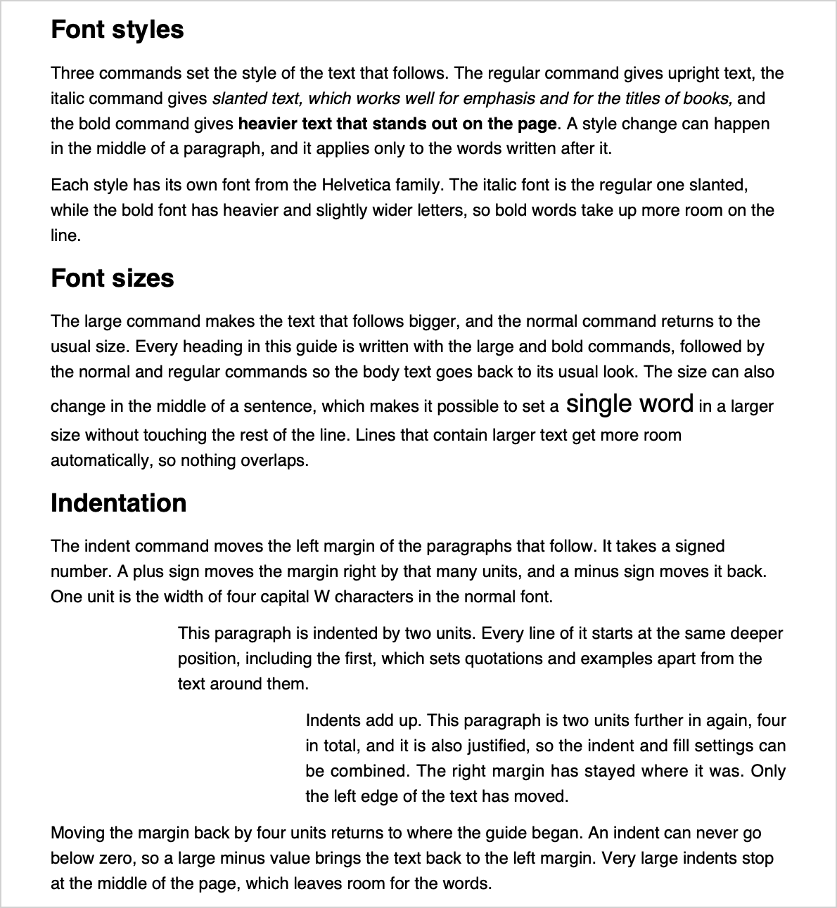

# PDF Typesetter

[](https://github.com/konstantinosioan/pdf-typesetter/actions/workflows/ci.yml)
[](LICENSE)

A command-line program that turns a plain text file with formatting commands, in the style of [roff](https://en.wikipedia.org/wiki/Roff_(software)), into a paginated PDF. It is written in Java 17 and uses iText to lay out the pages.

<a href="examples/guide.pdf"></a>

Part of page 2 of [examples/guide.pdf](examples/guide.pdf), made from [examples/guide.txt](examples/guide.txt).

## Usage

Put each command on its own line, with the dot in the first column. Every other line is text.

```text
.large
.bold
Meeting notes
.normal
.regular
.paragraph
The launch moves to
.italic
next spring
.regular
, after the budget review.
.fill
.indent +2
.paragraph
This paragraph is justified and indented by two units. Its lines are stretched so that
they reach both margins, apart from the last one.
```

Then pass the input file and the name of the PDF to create:

```sh
./mvnw -q compile exec:java -Dexec.args="notes.txt notes.pdf"
```

| Command | Effect |
| --- | --- |
| `.paragraph` | Starts a new paragraph |
| `.fill` | Justifies the following paragraphs to both margins |
| `.nofill` | Aligns the following paragraphs to the left with a ragged right edge (the default) |
| `.regular`, `.italic`, `.bold` | Sets the style of the text that follows |
| `.large`, `.normal` | Sets the size of the text that follows |
| `.indent +n`, `.indent -n` | Moves the left margin of the following paragraphs by n units |

Text lines are joined into paragraphs with single spaces, and each setting lasts until another command changes it. No space goes before closing punctuation such as `,` or `)`, or after an opening bracket, which is how `, after the budget review.` attaches to the italic words above. A text line that has to start with a dot needs `\&` in front of it. [examples/guide.txt](examples/guide.txt) uses every command and rule.

A mistake in the input stops the program before it writes anything. If line 8 above said `.itallic`, it would print:

```text
notes.txt:8: Unknown command: .itallic
```

The exit status is 0 on success, 1 when a file can't be read, parsed or written, and 2 when the arguments are wrong.

## Setup

You need JDK 17. The Maven Wrapper downloads Maven on first use, so there is nothing else to install.

```sh
git clone https://github.com/konstantinosioan/pdf-typesetter.git
cd pdf-typesetter
./mvnw -q compile exec:java -Dexec.args="examples/guide.txt guide.pdf"
```

## How it works

`Main` reads the input and passes its lines to `Parser`, which turns each command into a `Command` and applies it to a `DocumentBuilder`. The builder keeps track of the current style, size, fill mode and indent, and collects the text into an immutable `Document`. `ITextPdfRenderer` then lays that document out with iText, which takes care of line breaks, justification and page breaks.

Only the renderer depends on iText. The parser and builder can be tested without producing a PDF, and switching to a different PDF library would mean writing a new `PdfRenderer` without touching either of them.

## Design decisions

- Fill mode and indentation apply to a whole paragraph, so changing either one starts a new paragraph. Setting a value that is already in effect does nothing.
- `.indent` only accepts signed numbers. In roff, `.in 2` sets the indent to 2 while `.in +2` adds 2, so an unsigned number would be ambiguous.
- One indent unit is the width of `WWWW` in the normal font, about 16 mm. The indent never goes below zero and stops at half the text width, because iText silently drops a paragraph whose margin leaves no room for its text.
- Bold text uses Helvetica Bold, whose letters are heavier and a little wider, instead of iText's simulated bold, which only draws an outline around the regular letters. Italic text uses Helvetica Oblique, the slanted version of the regular font. PDF viewers must provide these standard fonts, or substitutes with the same letter widths, so nothing is embedded and files stay small.
- The whole input is parsed before the output file is opened, so a mistake in the input never creates or overwrites a PDF. The program also refuses to write over its own input, even through a symbolic link or, on a case-insensitive file system, a name that differs only in case.

## Limitations

- The standard fonts only cover Western European characters. Anything else, such as Greek or emoji, is left out of the PDF without a warning.
- The spacing rules ignore quote marks, because a straight `"` can open or close a quotation. A text line that starts with a closing quote gets a space before it.
- No-fill mode still wraps text to the page width, so the line breaks in the input are not kept as they would be in roff.
- All indents deeper than half the text width end up at the same position.
- If writing fails partway through, for example because the disk is full, a partial PDF can be left behind.

## Development

```sh
./mvnw test             # run the tests
./mvnw javadoc:javadoc  # build the API docs in target/reports/apidocs
```

The tests cover each stage on its own and the program as a whole. The renderer tests read the generated PDF back to check where lines start and end and which fonts and sizes they use. The command-line tests work in a temporary folder and include bad input such as a missing or non-UTF-8 file. The Javadoc build fails if anything public is undocumented. GitHub Actions runs the tests, the Javadoc build and the example on every push.

## License

Copyright (C) 2026 Konstantinos Ioannou

This program is free software: you can redistribute it and/or modify it under the terms of the GNU Affero General Public License as published by the Free Software Foundation, either version 3 of the License, or (at your option) any later version. It is distributed WITHOUT ANY WARRANTY. See [LICENSE](LICENSE) for the full terms.

It uses the AGPL instead of MIT because iText, the PDF library it depends on, is licensed under the AGPL.
